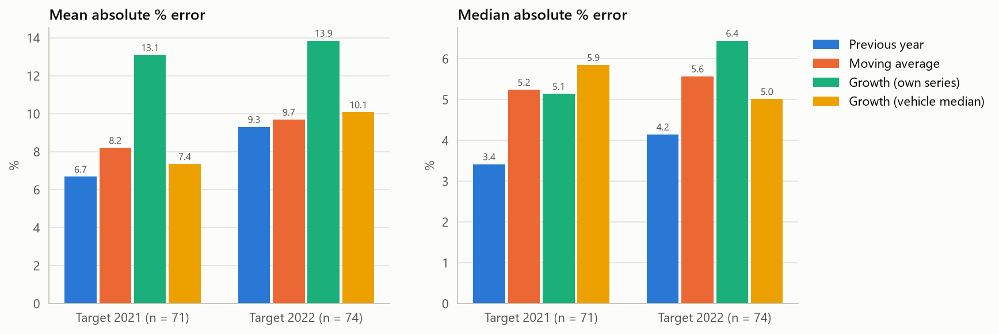
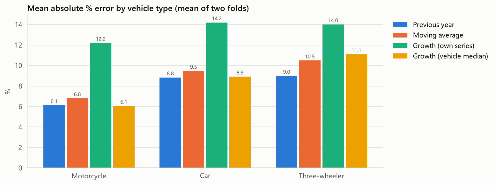
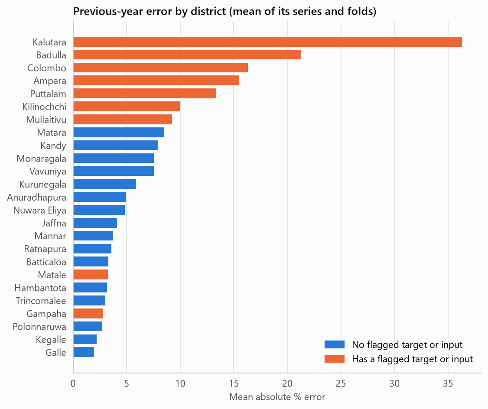
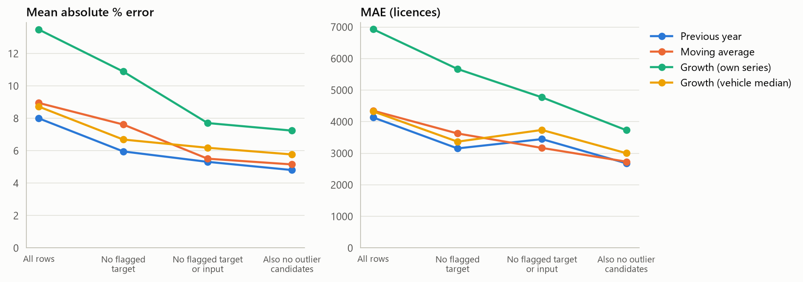
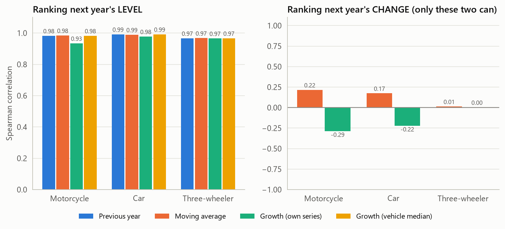
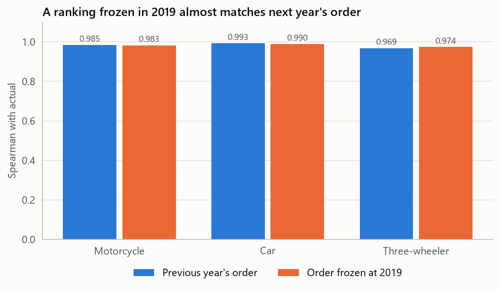

# Baseline Evaluation on Dataset v2

**Dataset:** `modelling_dataset_v2_04eaecafd7e1`
**Status:** approved by the project author on 2026-11-07. No machine-learning model has been trained, and target year 2023 was not evaluated.

## 1. Summary

The aim was to set an honest benchmark before any machine learning. Four simple forecasts of next-year revenue licences were compared on identical rows, for target years 2021 and 2022.

- **"Same as last year" was not reliably beaten.** It has a mean absolute percentage error of 8.00%, or 5.31% without flagged rows. A typical error is under 4%.
- **Growth forecasts did not help.** Continuing a series' own growth was clearly worse, with 67% higher MAE (95% interval 37% to 119%).
- **Ranking on levels is close to trivial.** Last year's order gives a Spearman correlation of 0.98. An order frozen in 2019 does equally well on the same rows (0.982).
- **Predicting change is the open problem.** No baseline ranked next-year change consistently across folds.
- **Flagged rows matter most.** They are 20% of rows, but their error is more than three times higher (18.87% against 5.32%).

Licence counts are a proxy for active vehicles, so none of these results measures mechanic demand.

## 2. Outlier candidates

Claude read the rendered PDF page for each of the eight EDA candidates. These judgements are recommendations awaiting the project author's confirmation, and **no value was changed**. The evidence is in `outlier_candidate_review.csv`.

**All eight values match the PDFs, so none is an extraction error, and none is clearly incorrect.**

| Candidate | Change | Table rows moving the same way | Total change | Reading | Recommendation |
|---|---:|---:|---:|---|---|
| Kandy motorcycles 2022 | +25.4% | 6 of 8 | +14.0% | Partial table change; the 2022 column is repeated in 2023 | Flag |
| Puttalam three-wheelers 2021 | -13.4% | 7 of 8 | -10.4% | District-wide dip | Flag |
| Puttalam motorcycles 2022 | +21.3% | 8 of 8 | +24.7% | Recovery from that dip | Flag |
| Colombo three-wheelers 2020 | +17.8% | 4 of 8 | +1.1% | Isolated spike, the most suspicious of the eight | Flag |
| Matara motorcycles 2022 | -12.0% | 7 of 8 | -12.9% | District-wide dip, recovering in 2023 | Flag |
| Kilinochchi cars 2022 | +29.6% | 6 of 8 | +1.6% | Steady trend on a very small base | Keep, no flag |
| Mannar motorcycles 2023 | -12.9% | 7 of 8 | -13.9% | District-wide fall, in the final test year | Flag |
| Colombo motorcycles 2022 | +16.2% | 8 of 8 | +14.2% | Recovery from a district-wide 2021 dip | Flag |

**Main point:** most of these are not bad cells. Whole tables move together in some district-years, which suggests a reporting or renewal effect at district level. **Decision (project author, 2026-11-07):** the candidates stay documented for sensitivity analysis, and Dataset v2 is not modified. The readings above remain recommendations that were not adopted as flags.

## 3. Feature selection for later models

Baselines use none of these as fitted inputs. The reasons come from the EDA, and the full list is in `feature_selection.csv`.

| Decision | Features | Why |
|---|---|---|
| Core | `licence_count`, `vehicle_type`, `licence_growth_log` | Level and type dominate; growth is the only momentum signal, though weak |
| Test as add-on | `licence_rolling_std_3`, `total_registrations`, `total_registrations_growth_log` | Must improve validation on the same rows to be kept |
| Excluded | `licence_lag_1`, `licence_rolling_mean_3`, `licence_lag_2`, `total_registrations_lag_1` | Near-duplicates or exact functions of the core inputs, or too few rows |
| Excluded | `district`, `year` | A raw identifier memorises size; a tree cannot extrapolate an unseen year |

## 4. Evaluation methodology

**Validation.** Chronological rolling-origin validation. Each forecast uses only values up to the origin year.

| Fold | Data available | Predicts | Rows |
|---|---|---|---:|
| Fold 1 | 2019-2020 | 2021 | 71 |
| Fold 2 | 2019-2021 | 2022 | 74 |
| Final test (**not run**) | 2019-2022 | 2023 | |

**Baselines.** Nothing is fitted.

| Baseline | Forecast for t + 1 |
|---|---|
| Previous year | Count in year t |
| Moving average | Mean of years t-2 to t |
| Growth (own series) | Count in t, grown by that series' growth from t-1 to t |
| Growth (vehicle median) | Count in t, grown by the median district growth for that vehicle type in year t |

**Identical rows.** A row is used only if every baseline has a forecast, so all are scored on the same 145 rows. Each sensitivity scenario removes rows for every model equally.

**Metrics.**

| Metric | Definition | Why |
|---|---|---|
| MAE | Mean absolute error, in licences | Directly interpretable, but dominated by large districts |
| MASE | MAE divided by the mean absolute one-year change up to the origin | Compares with typical past change. Below 1 means smaller errors than that |
| MAPE, median APE | Absolute percentage error | Treats districts of any size more equally |
| Spearman (level) | Rank correlation of forecast and actual, per vehicle type and year | Ranking quality |
| Top-N overlap | Share of the actual top N in the forecast top N (N = 3, 5, 10) | The districts users would see first |
| Spearman (change), direction | Ranking and sign of next-year change | Whether a forecast knows anything beyond level |

Fold results are averaged with equal weight, and ranking metrics are computed per vehicle type first. MASE uses a pooled scale because each series has too few years for its own, and fold 1's scale rests on one year of changes. The scale also differs by scenario, so MASE should only be compared within a scenario.

**Uncertainty.** 95% intervals come from 5,000 bootstrap resamples of whole series, because rows from one series are related.

**Missing and flagged data.** Rejected values stay missing, and their rows drop out. Nothing is filled in. Flagged values stay in the main results and are removed only in named scenarios.

## 5. Results

### 5.1 Accuracy, all rows

Mean of two folds, 145 rows.

| Baseline | MAE | MASE | MAPE | Median APE |
|---|---:|---:|---:|---:|
| Previous year | 4,136 | 1.00 | 8.00 | 3.79 |
| Moving average | 4,350 | 1.04 | 8.95 | 5.41 |
| Growth (own series) | 6,930 | 1.67 | 13.48 | 5.80 |
| Growth (vehicle median) | 4,327 | 1.05 | 8.72 | 5.43 |



| Previous year, by fold | MAE | MASE | MAPE | Median APE |
|---|---:|---:|---:|---:|
| Target 2021 | 3,379 | 0.75 | 6.69 | 3.42 |
| Target 2022 | 4,893 | 1.26 | 9.31 | 4.15 |

Target 2022 has larger errors. Its rows include recoveries from 2021 dips (Colombo and Puttalam) and Kalutara's flagged fall.

### 5.2 Compared with the previous-year baseline

MAE ratio to the previous-year baseline, with 95% interval. Below 1 is better.

| Baseline | All rows (145) | No flagged target or input (116) |
|---|---:|---:|
| Moving average | 1.05 (0.87 to 1.38) | 0.92 (0.84 to 1.05) |
| Growth (own series) | 1.67 (1.37 to 2.19) | 1.38 (1.27 to 1.54) |
| Growth (vehicle median) | 1.05 (0.99 to 1.12) | 1.09 (1.03 to 1.19) |

The moving average has a lower MAE on clean rows, but the interval includes 1 and its MAPE is no better (5.51 against 5.31), so it is not a clear improvement.

### 5.3 By vehicle type

All rows, mean of two folds.

| Vehicle type | Baseline | MAE | MAPE | Median APE |
|---|---|---:|---:|---:|
| Motorcycle | Previous year | 7,185 | 6.12 | 2.84 |
| | Moving average | 6,957 | 6.81 | 4.70 |
| | Growth (vehicle median) | 7,089 | 6.06 | 2.68 |
| Car | Previous year | 2,057 | 8.82 | 5.06 |
| | Moving average | 1,766 | 9.47 | 6.27 |
| | Growth (vehicle median) | 2,192 | 8.91 | 5.71 |
| Three-wheeler | Previous year | 3,290 | 8.98 | 4.47 |
| | Moving average | 4,432 | 10.48 | 6.11 |
| | Growth (vehicle median) | 3,812 | 11.09 | 7.21 |

Differences between baselines in one vehicle type are small and rest on about 24 rows per fold, so they should not be over-interpreted. Growth (own series) has the highest MAE and MAPE in every vehicle type and is omitted here; it is in `metrics_summary.csv`.



### 5.4 By district

Previous-year error (mean of each district's series and folds) ranges from 2.0% in Galle to 36.3% in Kalutara. The largest are Kalutara, Badulla (21.3%), Colombo (16.3%), Ampara (15.5%) and Puttalam (13.4%). Most of these involve flagged values, or the district-wide dips described in Section 2. Full results are in `errors_by_district.csv`.



### 5.5 With and without flagged records

Mean of two folds. Scenarios change which rows are scored, so compare baselines **within** a scenario. MAE across scenarios can mislead: it can rise when rows from small districts are removed.

| Scenario | Rows | Previous year: MAE, MAPE | Moving average: MAE, MAPE | Growth (own series): MAE, MAPE | Growth (vehicle median): MAE, MAPE |
|---|---:|---:|---:|---:|---:|
| All rows | 145 | 4,136, 8.00 | 4,350, 8.95 | 6,930, 13.48 | 4,327, 8.72 |
| No flagged target | 138 | 3,154, 5.96 | 3,628, 7.62 | 5,670, 10.89 | 3,368, 6.69 |
| No flagged target or input | 116 | 3,449, 5.31 | 3,169, 5.51 | 4,772, 7.71 | 3,739, 6.18 |
| Also no outlier candidates | 111 | 2,682, 4.81 | 2,734, 5.16 | 3,731, 7.24 | 3,003, 5.77 |

Pooled across rows, the previous-year MAPE is 5.32% on the 116 rows without a flagged target or input, and **18.87%** on the 29 rows with one (median 3.20% against 10.11%, maximum 20.25% against 67.00%). The previous-year baseline has the lowest MAPE in every scenario.

Removing the eight candidates only lowers MAPE from 5.31% to 4.81%, so they are not driving results.



### 5.6 Ranking quality

Mean across vehicle types and folds, all rows.

| Baseline | Spearman (level) | Top-3 | Top-5 | Top-10 | Spearman (change) | Top-5 of change | Direction correct |
|---|---:|---:|---:|---:|---:|---:|---:|
| Previous year | 0.980 | 0.889 | 0.967 | 0.933 | not possible | not possible | not possible |
| Moving average | 0.981 | 0.889 | 0.967 | 0.950 | 0.134 | 0.433 | 0.544 |
| Growth (own series) | 0.959 | 0.778 | 0.900 | 0.883 | -0.170 | 0.200 | 0.429 |
| Growth (vehicle median) | 0.980 | 0.889 | 0.967 | 0.933 | not possible | not possible | 0.497 |

Previous year and vehicle-median growth give every district in a vehicle type the same change, so they cannot rank change at all. For scale, randomly picking 5 of about 24 districts would give a top-5 overlap of about 0.21.



## 6. Key research findings

### Does predicting levels mainly reproduce stable rankings?

**Yes, in this evaluation.** On rows where a 2019 value exists:

| Order used to predict | Spearman | Top-3 | Top-5 | Top-10 |
|---|---:|---:|---:|---:|
| Previous year | 0.982 | 0.889 | 0.967 | 0.933 |
| Frozen at 2019 | 0.982 | 0.944 | 0.967 | 0.933 |

An order fixed before the evaluation years does as well as the latest one. 40% of districts do change rank, but only by about 0.6 places on average. A model with a high level-ranking score has therefore shown very little, so ranking results must always be compared with this benchmark.



### Does growth history help predict change?

**Not reliably.** The moving average's positive score (0.134) comes almost entirely from fold 2: about 0 in fold 1, and 0.43, 0.29 and 0.09 by vehicle type in fold 2. That looks like recovery from the 2021 dips, not a stable pattern. Continuing recent growth is negative overall (-0.170). The direction of change is about as good as a coin toss (0.43-0.54).

### Should a growth-based target also be investigated?

**Yes, as a secondary analysis, with realistic expectations.**

- **Why:** level forecasts are dominated by what is already known. Change is the only place where a model could add information about the future, and it would also suit the project's aim better than restating fleet size.
- **How:** predict log next-year change, convert forecasts back to counts, and score them on the same rows and metrics. The approved target stays primary.
- **Caution:** the evidence so far is weak. Change is noisy, its extremes are concentrated in flagged rows, and the data has few years. A "no predictable signal" result is possible and would be valid.

## 7. Limitations

1. **Target year 2023 was not evaluated, but it is not truly unseen.** EDA and cleaning displayed its values, the EDA's rank stability figures included 2022 to 2023, reading Mannar's PDF added to what is known, and it is already known that Kandy 2023 repeats 2022. Results on it must be described with this disclosed.
2. **Very few folds.** Two folds give two years of evidence, and both overlap the 2020-2022 structural break.
3. **Few rows for later models.** With 2023 reserved and full features, an ML model has only one development fold: train on target year 2021, validate on 2022. With only `licence_count` and `vehicle_type`, target year 2020 is also usable, which gives two.
4. **Selection effect.** Row filters need a 2-year history, so rows from target year 2020 and rows beside rejected values are absent.
5. **Hindsight.** Flags and corrections were decided using all years, so the "clean" scenarios could not be reproduced in a live forecast.
6. **Interval limits.** The bootstrap covers sampling across series, not the small number of years or errors shared by a whole district table.
7. **Proxy target.** Licences reflect renewals, and neither they nor these rankings measure mechanic demand.
8. **Reviewed by Claude.** The outlier readings were made by Claude and need the project author's confirmation.

## 8. Next modelling steps

**Success criteria, fixed before any model is trained and accepted by the project author on 2026-11-07.** Uncertainty and limitations must be reported alongside them. On identical development rows, a model counts as better than the previous-year baseline only if it meets all of these:

1. Lower MAE **and** lower MAPE, on all rows **and** on rows without flagged values.
2. The 95% bootstrap interval for its MAE ratio lies below 1. Otherwise, the result is reported as no clear improvement.
3. Its Spearman and top-5 overlap on levels are no lower than the previous-year baseline's.
4. For any claim about change, a positive Spearman (change) in each vehicle type.

**Order of work:**

1. Keep target year 2023 reserved, and the eight candidates as a sensitivity scenario.
2. Train Ridge first, then Random Forest and XGBoost if justified, with the core features and then the add-ons, always on the same rows.
3. Compare the level target with log change.
4. Freeze the chosen approach, including the baseline comparison, and only then run the final test on 2023, once.
5. Decide how to log those runs in MLflow without changing the existing v1 store.

## 9. Reproducing the results

```
python -m src.evaluation.baseline_evaluation_v2
```

The pipeline stops unless the dataset matches the frozen Dataset v2 hash. It writes only to `reports/baseline_v2/`, and rerunning it gives identical tables.
