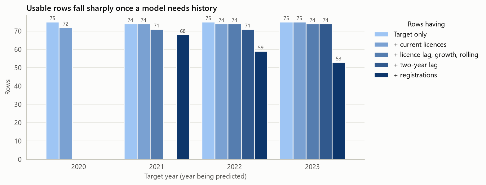
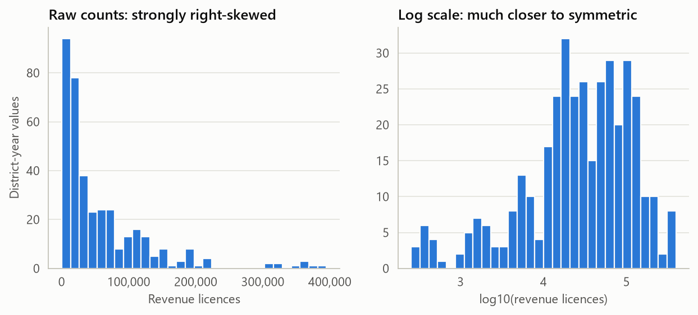
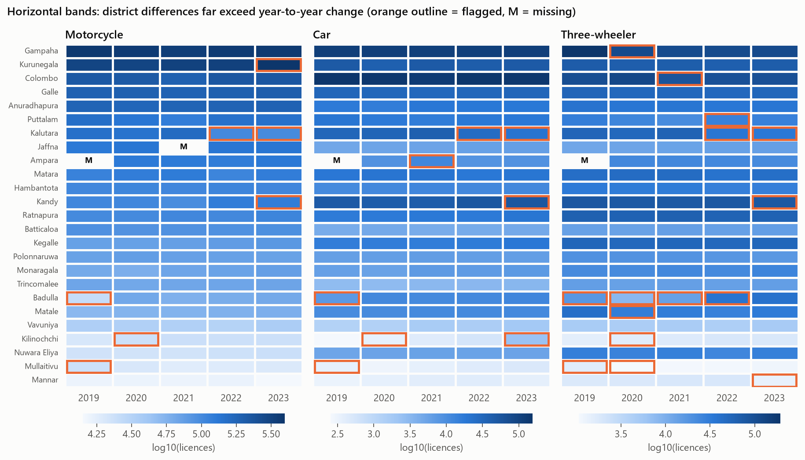
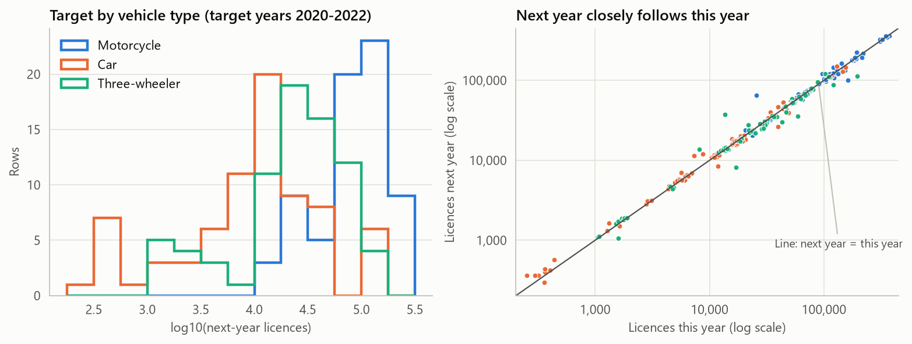
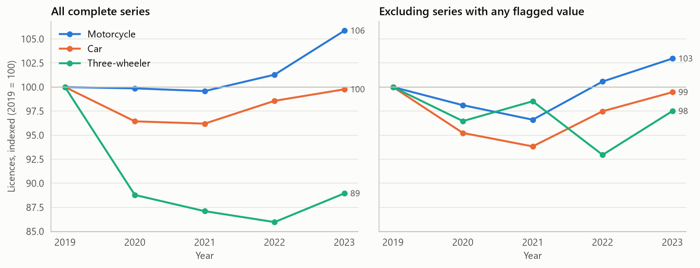
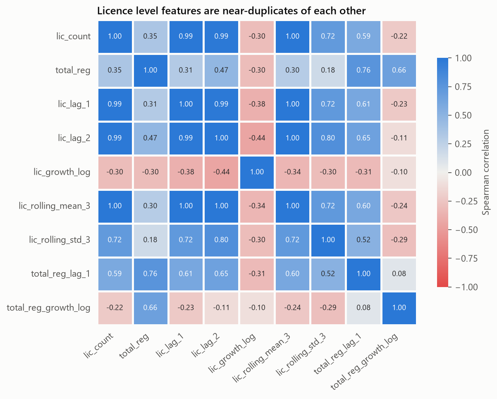
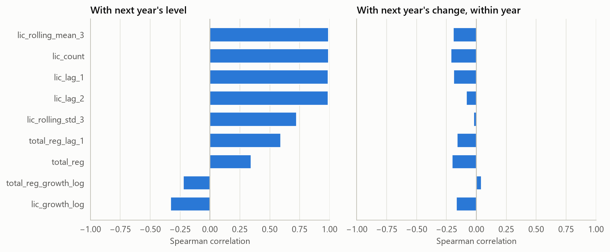
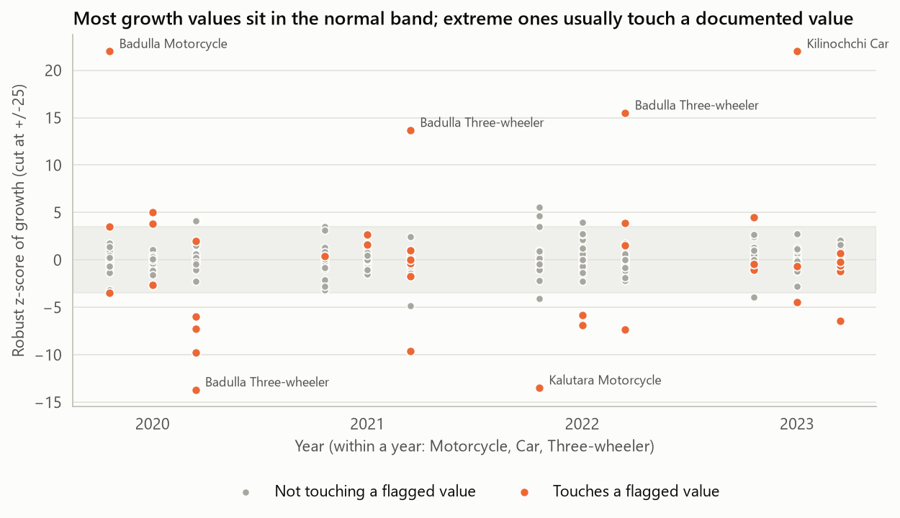
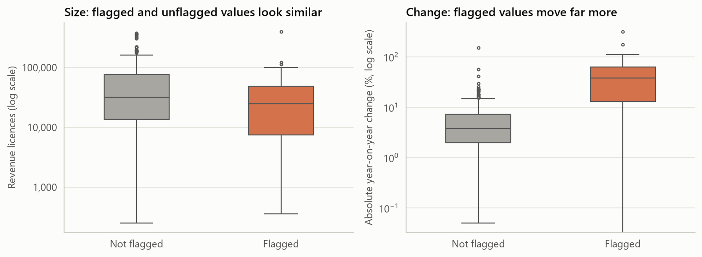
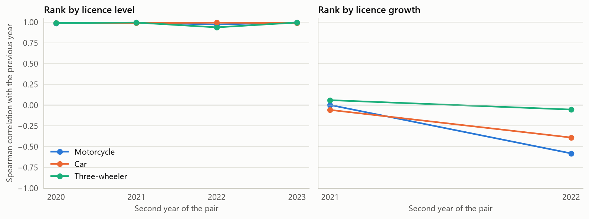

# Exploratory Data Analysis of Dataset v2: Report

**Dataset:** `modelling_dataset_v2_04eaecafd7e1`
**Notebook:** `notebooks/eda_dataset_v2.ipynb` (22 charts, all in `reports/eda_v2/figures/`)
**Status:** approved by the project author on 2026-11-07. No model has been trained.

## 1. Summary

Dataset v2 gives a clean and very stable picture of how vehicle fleets differ between districts. It is much weaker as a basis for predicting change.

- **Districts differ hugely.** Over 98% of the variation in log licences is between districts.
- **Licences barely change.** The median year-on-year change is 4.0%, so "same as last year" is a hard benchmark to beat.
- **No feature strongly predicts change.** The strongest within-year correlation with next-year change is only about -0.21.
- **Rankings are stable but mostly measure size.** Level rankings hardly move, and growth rankings do not persist.
- **Suspicious values drive the extremes.** Removing them nearly halves the mean next-year change, and it removes every change above about 25%.

The main implication for the ML phase is that a good score on licence levels would prove very little. Models must be judged against a persistence baseline, and also on next-year change.

## 2. Dataset overview

| Item | Value |
|---|---:|
| Rows (25 districts x 5 years x 3 vehicle types) | 375 |
| Columns | 39 |
| Model features | 10 |
| Rows with a target | 299 |
| Development rows for feature-target analysis (target years 2020-2022) | 224 |
| Duplicate district-year-vehicle keys | 0 |

| Vehicle type | Median licences | Smallest | Largest | Largest / smallest |
|---|---:|---:|---:|---:|
| Motorcycle | 98,598 | 14,102 | 394,975 | 28 |
| Car | 11,428 | 254 | 154,948 | 610 |
| Three-wheeler | 28,827 | 1,056 | 194,704 | 184 |

**How leakage was avoided.** Any analysis relating features to the target uses development rows only, with target year 2023 held back as the future final test. Descriptive charts of licence levels do include 2023, and those values were also seen during data cleaning. So 2023 is protected from feature selection, but it is not completely unseen.

## 3. Key visualizations and findings

Each finding answers three questions: what we discovered, why it matters, and how it could affect the ML methodology. The notebook has 11 findings and an explanation under every chart.

### Finding 1: Usable data depends on the features chosen

- **Discovered:** of 299 rows with a target, 295 also have current licences, 219 have lag, growth and rolling features, 180 have registrations as well, and 145 have the two-year lag.
- **Why it matters:** the true sample size decides how many validation folds are possible.
- **ML effect:** full licence features allow only two rolling-origin folds. Feature sets must be compared on the same rows.
- **Observation or assumption:** an observation.

### Finding 2: Licence counts are strongly right-skewed

- **Discovered:** skewness is 2.29 on the raw scale and -0.85 on a log scale. The mean (57,830) is nearly twice the median (31,233).
- **Why it matters:** raw-scale metrics would mostly reflect the largest districts.
- **ML effect:** consider training on a log scale while reporting in raw counts, and add scale-independent metrics such as MASE.
- **Observation or assumption:** the skew is observed. That a log transform improves modelling is an assumption to test.

### Finding 3: District differences far outweigh change over time

- **Discovered:** 98.4-98.7% of the variation in log licences lies between districts. The top 5 of 25 districts hold 45.4% of motorcycle, 46.4% of three-wheeler and 67.0% of car licences.
- **Why it matters:** a model can reach a high R-squared simply by remembering district size.
- **ML effect:** do not treat R-squared on levels as evidence of skill, and avoid a raw district identifier.
- **Observation or assumption:** an observation, on series with complete values.

### Finding 4: The fleet is stable, but registrations are not

- **Discovered:** the median year-on-year licence change is 4.0%, and 76% of changes are within 10%. Printed registrations fell by 94.0%, from 342,064 in 2019 to 20,488 in 2022.
- **Why it matters:** next year is usually very close to this year, and the two indicators clearly measure different things.
- **ML effect:** a persistence baseline is essential. Registration features span a structural break.
- **Observation or assumption:** the sizes are observed. The cause is an assumption: project documents link 2020-2022 to economic conditions and import restrictions, but this data cannot show the cause, and a citation is still needed.

### Finding 5: The three-wheeler trend depends on data quality

- **Discovered:** with all complete series, three-wheelers fall to 89.0 by 2023 (2019 = 100). Excluding series with a flagged value, they reach 97.5. Motorcycles move from 105.9 to 103.0, and cars from 99.8 to 99.5.
- **Why it matters:** a claim that three-wheeler fleets declined would rest largely on doubtful values.
- **ML effect:** national trends should not be quoted, or used as a feature, without this caveat.
- **Observation or assumption:** the figures are observed. The two panels cover different districts, so they are not a like-for-like comparison.

### Finding 6: Licence level features are nearly duplicates

- **Discovered:** level features correlate at 0.99-1.00. Variance inflation factors are 491 for licence count, 401 for lag 1 and 1,428 for the rolling mean. Without lag 1 and the rolling mean, all fall below 5. `licence_growth_log` is an exact function of licence count and lag 1.
- **Why it matters:** the effects of these features cannot be separated, and SHAP explanations would be unstable.
- **ML effect:** start with one level feature, and avoid using all three together without regularisation.
- **Observation or assumption:** an observation, on 127 complete development rows.

### Finding 7: No feature strongly predicts next-year change

- **Discovered:** licence features correlate about 0.99 with next year's level, which mainly reflects size. With next-year change, within year, the strongest are `licence_count` (-0.21) and `total_registrations` (-0.20). `total_registrations_growth_log` appears as +0.16 when years are pooled but only +0.04 within year, and its sign differs by vehicle type.
- **Why it matters:** the apparent signal in registration growth is largely a calendar effect.
- **ML effect:** test registrations as an add-on only. Drop `licence_lag_2`. ML may add little, and that would be a valid research result.
- **Observation or assumption:** the correlations are observed. A non-linear or combined effect is not ruled out, and correlation does not show causation.

### Finding 8: Growth-based outlier checks are more useful than level-based ones

- **Discovered:** a Tukey rule on levels only identifies Gampaha, Kurunegala, Colombo and Kandy, which are simply large districts. A robust score on growth finds 28 outliers among 295 growth values: 20 touch an already flagged value, and **8 are new candidates**.
- **Why it matters:** removing outliers by level would delete real, important districts.
- **ML effect:** do not remove outliers automatically; prefer robust losses. Review the candidates against the PDFs.
- **Observation or assumption:** the threshold is a convention (3.5). A large deviation may be a real change, so these are only candidates.

### Finding 9: Suspicious values affect the tails more than the middle

- **Discovered:** 30 of 375 values are flagged, and 24 of 299 targets. Flagged values are similar in size to others (medians 24,800 and 31,732), but change far more (38.3% against 3.8%). Without flagged rows, the mean next-year change falls from 9.4% to 5.3%, the median from 4.1% to 3.5%, and the maximum from 174.8% to 25.4%.
- **Why it matters:** a few doubtful values could drive average error metrics.
- **ML effect:** report every metric with and without flagged rows. Target year 2023 has 9 flagged targets, and Kandy's 3 repeat 2022 exactly, which would flatter a persistence forecast.
- **Observation or assumption:** the difference in change is partly circular, because many values were flagged for unusual change. Flagged values are uncertain, not proven wrong.

### Finding 10: Rankings are stable, but mostly measure size

- **Discovered:** consecutive-year rank correlations for levels are 0.937-0.995, and at least 4 of the top 5 stay each time. Growth rankings do not persist (-0.581 to +0.060). Kurunegala passes Gampaha in motorcycles only in 2023, on a flagged value.
- **Why it matters:** the data supports a description of fleet size, not claims about the fastest-growing districts.
- **ML effect:** evaluate rankings against "keep this year's order", and present broad opportunity bands rather than exact positions.
- **Observation or assumption:** the rank correlations are observed. That fleet size indicates service opportunity is the project's proxy assumption, which cannot be tested without mechanic-demand data.

## 4. Answers to the research questions

| Question | Answer | Confidence |
|---|---|---|
| How do licence counts vary across districts? | Very widely. Over 98% of variation is between districts, and the vehicle mix also differs (motorcycle share 40.0-93.0%). | High |
| How stable are fleet indicators? | Licences are very stable. Registrations fell by 94.0% from 2019 to 2022. | High for the pattern; the cause is an assumption |
| Which features appear useful? | `licence_count` and `vehicle_type` for level. Nothing is strongly related to next-year change. | Medium: correlations over two or three target years |
| How might suspicious values affect results? | They drive extreme changes and the largest rank moves, and could flatter or penalise models. | Medium: flagged values are uncertain |
| Does the dataset support meaningful rankings? | Yes as a stable description of fleet size, in broad bands. No as evidence of growth rankings, or of forecasting skill beyond this year's order. | Medium: depends on the proxy assumption |

## 5. Data-quality limitations

1. **Proxy target.** Licences approximate active vehicles. Neither licences nor registrations measure mechanic demand.
2. **Eight new outlier candidates, not reviewed against the PDFs:** Kandy motorcycles 2022, Puttalam three-wheelers 2021, Puttalam motorcycles 2022, Colombo three-wheelers 2020, Matara motorcycles 2022, Kilinochchi cars 2022, Mannar motorcycles 2023 and Colombo motorcycles 2022. They stay in the dataset unchanged and are not yet in the corrections file.
3. **Uncertain values remain.** Five flagged values sit inside a top 5: Kandy cars and three-wheelers 2023, Kurunegala motorcycles 2023, Gampaha three-wheelers 2020 and Colombo three-wheelers 2021.
4. **Registrations.** 12 Totals are unverified, and registrations span a sharp structural break. The verified share of printed Totals drops to 77.1% in 2021.
5. **Short series.** Five years, and only two target years with full licence features in the development period. Correlations rest on few years.
6. **Dependent rows.** Rows from one district are related, so p-values are descriptive only.
7. **Missing context.** There is no population, vehicle age, price or competition data, so rankings cannot be per capita.

## 6. Recommendations for feature selection and ML

**Features**

| Feature | Recommendation | Reason |
|---|---|---|
| `licence_count` | Keep as the core level input | Strongest and most complete |
| `vehicle_type` | Keep | Vehicle types differ greatly |
| `licence_growth_log` | Keep, and test | Weak link to change, but the only momentum signal |
| `licence_rolling_std_3` | Test as an add-on | Different information from level (VIF 2.4), but no clear link to change |
| `licence_lag_1`, `licence_rolling_mean_3` | Avoid alongside `licence_count` unless regularised | Near-duplicates |
| `licence_lag_2` | Drop | One development target year, 71 rows |
| Registration features | Test as an add-on, on the same rows | Weak, calendar-driven, and cost 39 rows |

**Modelling**

1. **Baselines first:** "same as last year" and a moving average.
2. **Validation:** rolling-origin. With full licence features, train on target year 2021 and test on 2022, then train on 2021-2022 and test on 2023. Use 2023 once, as the final test.
3. **Target scale:** report raw counts. Compare training on log level and on log change.
4. **Models:** simple and regularised, given about 219 rows. Start with Ridge. Random Forest and XGBoost need strong regularisation, and trees cannot predict beyond the values seen in training unless they predict change.
5. **Metrics:** MAE, MAPE and MASE; Spearman and top-N overlap per vehicle type; and skill on next-year change. Do not rely on R-squared on levels.
6. **Data quality:** report every result with and without flagged rows. Fit any scaling inside each training fold.
7. **Honest conclusions:** if ML does not beat persistence, report it. That is a valid answer to RQ3.

## 7. Reproducing this analysis

The notebook reads Dataset v2 only, confirms its hash before and after running, and writes only to `reports/eda_v2/`. Its final cells assert the headline numbers quoted in the notebook's explanations, so it fails if the text and data stop matching.
