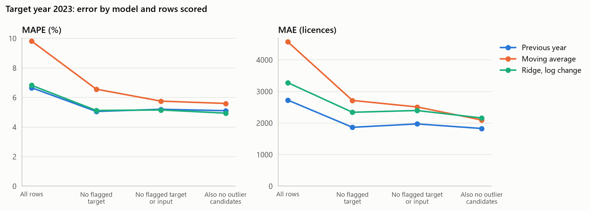
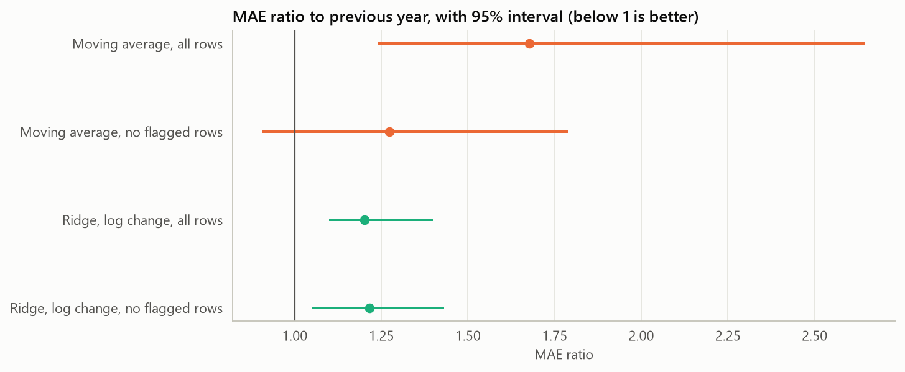
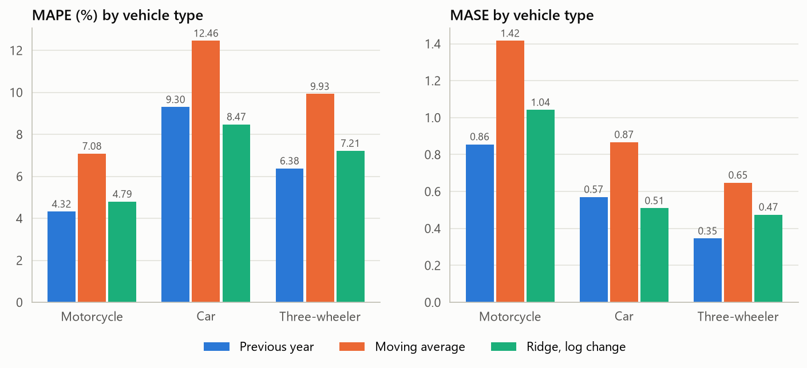
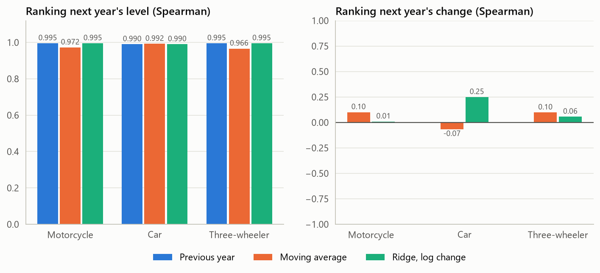
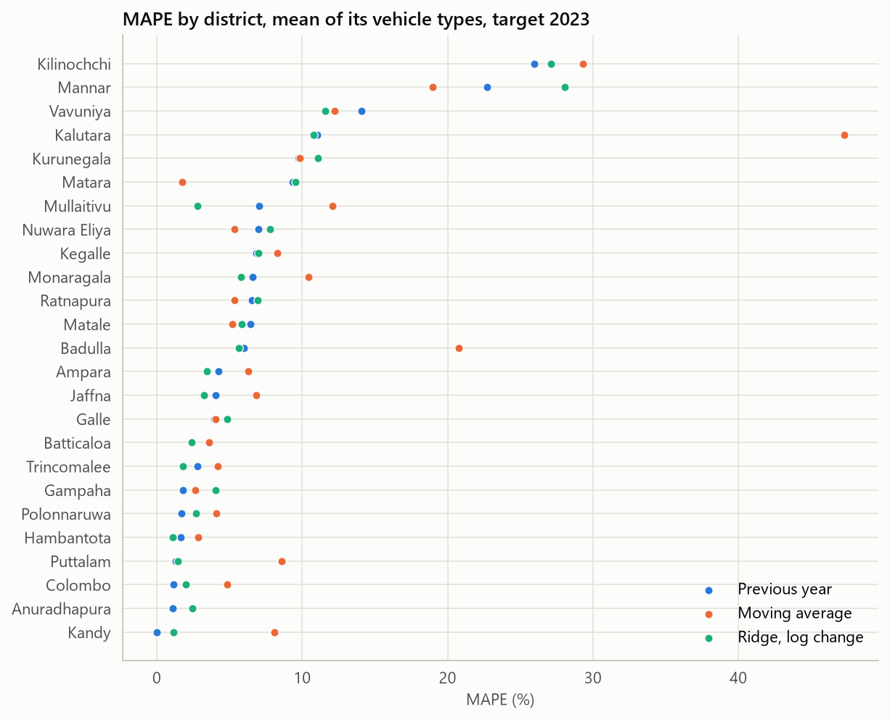

# Final Evaluation on Target Year 2023

**Dataset:** `modelling_dataset_v2_04eaecafd7e1`
**Plan:** `final_evaluation_v2_plan_1`, in `evaluation_plan.md`
**Status:** approved by the project author on 2026-11-07. Results are unchanged since the single run.

## 1. Summary

Three frozen approaches were evaluated on target year 2023, exactly once, under a plan fixed before any result was computed.

- **The previous-year baseline performed best,** with the lowest MAE (2,729) and the lowest MAPE (6.66%).
- **No model met the rule for a meaningful accuracy improvement.** Ridge's MAE was 20% higher than the baseline's, with a 95% interval of 1.10 to 1.40.
- **Ranking did not improve.** The baseline and Ridge have the same level ranking (Spearman 0.994, top-5 overlap 1.00), and the moving average was lower.
- **The answer to the research question is no:** on this evidence, machine learning did not improve predictions of next-year revenue licences or district rankings beyond last year's values.

This is one year of evidence. Revenue-licence counts are a **proxy** indicator for active vehicles and are **not actual mechanic-service demand**, so none of these results measures jobs, customers or income.

## 2. What was evaluated

| Item | Frozen value |
|---|---|
| Models | Previous year (reference); moving average of 2020-2022; Ridge on log change |
| Ridge inputs | Log `licence_count` and `vehicle_type` |
| Ridge preprocessing | `StandardScaler` and `OneHotEncoder`, fitted on training rows only |
| Ridge penalty | `alpha = 100`, from Step 6, not tuned again |
| Training rows | 220, target years 2020-2022, flagged rows included |
| Evaluation rows | 75 identical rows, target year 2023 |
| Missing values | Not imputed |

**How the plan was protected.**
- **Rehearsal:** the whole pipeline first ran in a scratch folder on artificial 2023 values, printing no score.
- **Freeze:** at 05:42:06 on 2026-11-07, hashes of the plan, frozen code, configs and dataset were recorded (`freeze_record.json`), with the repository at commit `37a5601`.
- **Single run:** the lock was created at 05:42:11, the one real run followed, and a second run is refused.
- **Blind forecasts:** forecasts were made from a copy with every 2023 value removed.
- **After the run:** no model, feature, penalty or rule changed, and no further experiment was run.

**A limit of this evidence.** The plan was not committed to git before the run, so its order rests on the freeze record and lock timestamps, not on a git history entry.

## 3. Results, all rows

Target year 2023, 75 rows. This is the primary result.

| Model | MAE | MASE | MAPE | Median APE | Spearman (level) | Top-5 |
|---|---:|---:|---:|---:|---:|---:|
| **Previous year** | **2,729** | **0.64** | **6.66** | 4.00 | 0.994 | 1.00 |
| Moving average | 4,574 | 1.08 | 9.82 | 5.90 | 0.977 | 0.93 |
| Ridge, log change | 3,279 | 0.77 | 6.83 | 3.65 | 0.994 | 1.00 |

**Reading the table.** MASE below 1 means errors are smaller than the typical one-year change up to 2022. The baseline's 0.64 is not evidence of forecasting skill: the history behind the scale includes some very large changes, which raise it. The typical yearly change in 2023 (median 3.9%, from the EDA) was similar to other years.

Ridge has a lower **median** error than the baseline (3.65 against 4.00) and a lower error on 37 of 75 rows, close to half. Its MAE is larger mainly because of large series, which dominate MAE. For the 15 largest series, Ridge forecast a fall in every case, but 12 of them actually rose.

## 4. Decision rules

MAE ratio to the previous-year baseline, with 95% interval. Below 1 is better.

| Model | All rows (75) | No flagged target or input (57) |
|---|---:|---:|
| Moving average | 1.68 (1.24 to 2.65) | 1.27 (0.91 to 1.79) |
| Ridge, log change | 1.20 (1.10 to 1.40) | 1.22 (1.05 to 1.43) |

| Frozen rule | Moving average | Ridge, log change |
|---|---|---|
| Lower MAE and MAPE on both row sets | No | No |
| MAE ratio interval entirely below 1 on both | No | No |
| **Meaningful accuracy improvement** | **No** | **No** |
| Level ranking no lower than the baseline's | No | Yes, identical by construction |
| Positive change ranking in every vehicle type | No | Yes, but see below |

**The change rule is met, but this supports no practical claim.** Ridge's change rankings are 0.009, 0.249 and 0.056. They are exactly the "smaller districts change more" rule, which needs no model. The motorcycle value is effectively zero, and direction accuracy is 0.514, about a coin toss. The rule was fixed in advance and is reported as met, but this is one year, and it was also not stable in development.

**Best-performing approach:** the previous-year baseline, on both frozen measures, MAE and MAPE. This describes one year.

## 5. By vehicle type

All rows, 25 rows per vehicle type.

| Vehicle type | Model | MAE | MASE | MAPE | Median APE | Spearman (level) | Top-5 |
|---|---|---:|---:|---:|---:|---:|---:|
| Motorcycle | Previous year | 5,599 | 0.86 | 4.32 | 2.90 | 0.995 | 1.00 |
| | Moving average | 9,266 | 1.42 | 7.08 | 4.58 | 0.972 | 1.00 |
| | Ridge, log change | 6,819 | 1.04 | 4.79 | 2.23 | 0.995 | 1.00 |
| Car | Previous year | 1,116 | 0.57 | 9.30 | 4.54 | 0.990 | 1.00 |
| | Moving average | 1,697 | 0.87 | 12.46 | 6.74 | 0.992 | 0.80 |
| | Ridge, log change | 997 | 0.51 | 8.47 | 3.28 | 0.990 | 1.00 |
| Three-wheeler | Previous year | 1,471 | 0.35 | 6.38 | 4.00 | 0.995 | 1.00 |
| | Moving average | 2,758 | 0.65 | 9.93 | 6.05 | 0.966 | 1.00 |
| | Ridge, log change | 2,022 | 0.47 | 7.21 | 4.76 | 0.995 | 1.00 |

**Cars are the one exception,** where Ridge has a lower MAE and MAPE than the baseline, also on rows without flags (816 against 962, and 5.14 against 5.98). This should **not** be claimed as a finding: it was not a planned comparison, it has no interval, it covers 25 rows in one year, and development results for cars were close to a tie (MAPE 8.87 against 8.82). It is at most a question for later work.

## 6. Sensitivity to flagged observations

The same rows are removed for every model. Compare models within a row. MASE and MAE across rows can mislead, as each scenario keeps different districts.

| Rows scored | Rows | Previous year: MAE, MAPE | Moving average: MAE, MAPE | Ridge: MAE, MAPE |
|---|---:|---:|---:|---:|
| All rows | 75 | 2,729, 6.66 | 4,574, 9.82 | 3,279, 6.83 |
| No flagged target | 66 | 1,866, 5.06 | 2,718, 6.57 | 2,342, 5.13 |
| No flagged target or input | 57 | 1,973, 5.21 | 2,511, 5.76 | 2,398, 5.16 |
| Also no outlier candidates | 53 | 1,828, 5.11 | 2,096, 5.60 | 2,161, 4.94 |

- **The baseline has the lowest MAE in every row.**
- **On MAPE, Ridge is slightly lower in the last two rows** (5.16 against 5.21, and 4.94 against 5.11), by under 0.2 points, with a higher MAE. The interval for that MAPE gap on the 57 rows includes zero (-0.60 to 0.55).
- **Removing Kandy's repeated 2023 values does not rescue the models.** Those 3 rows gave the baseline zero error, as disclosed in the plan, but it still leads with them removed.

**Flagged rows are less predictable.** On the 18 rows with a flagged target or input, baseline MAPE is 11.29%, against 5.21% on the other 57. The median (3.19% against 4.10%) is lower only because Kandy's rows have zero error, so the difference lies in a few extreme rows.

**A few values dominate MAE.** Kurunegala motorcycles alone (325,140 to 394,975, a flagged value) make up 34% of the baseline's total absolute error.

## 7. Ranking quality

Previous-year forecast and Ridge have identical level rankings within each vehicle type, as Ridge's forecast depends only on size. Neither can improve on the existing order.

| Order used to predict 2023 | Spearman | Top-3 | Top-5 | Top-10 |
|---|---:|---:|---:|---:|
| Previous year | 0.993 | 1.00 | 1.00 | 0.90 |
| Frozen at 2019 | 0.968 | 0.89 | 0.93 | 0.83 |

These use the 24 districts per vehicle type with a 2019 value. Last year's order is better than the 2019 order here, unlike in development, where they tied. Even the 2019 order is close, which confirms that rankings mainly reflect stable differences in size.

**Overlap hides some change.** All three top-5 motorcycle lists match, yet Kurunegala passed Gampaha for first place in 2023 on a flagged value. All three forecasts keep Gampaha first.

## 8. By district

Errors are mostly small but vary widely, as shown below. The highest baseline errors are in Kilinochchi (25.9%), Mannar (22.7%), Vavuniya (14.1%) and Kalutara (11.0%). Most of these are small series or involve flagged values, and no model is consistently better across them. Full results are in `errors_by_district.csv`.

## 9. Research conclusions

1. **Machine learning did not improve prediction of next-year revenue licences,** on development folds or on 2023. A negative result, reached under a frozen plan, is a valid answer to the research question.
2. **The target is highly persistent.** Next year's count is usually very close to this year's, leaving little for a model to learn from these features.
3. **District rankings mainly reflect stable fleet size.** They support a description of where vehicles are, in broad bands. They do not show a forecasting advantage.
4. **Data quality matters as much as the model.** A few doubtful values drive the largest errors, for all three approaches.
5. **The simplest forecast is the most defensible,** given that nothing beat it. Any recommendation output should be presented as describing the current fleet, with its limitations.

**What this does not show.** It does not show that ML could never help, that any district has more mechanic work, or that fleet size causes demand.

## 10. Limitations

1. **Proxy, not demand.** Licences reflect renewals of active vehicles. This is not actual mechanic-service demand, and it cannot be validated against job data, because no such data exists.
2. **One year.** A single target year cannot show that a result holds in general. The baseline's MAE varied across years (3,379, 4,893 and 2,729 for 2021, 2022 and 2023).
3. **2023 is not truly unseen.** EDA and cleaning displayed its values, EDA reported 2022-to-2023 rank stability, and the outlier review read Mannar's 2023 column. Kandy's repeat was known in advance. No model setting was chosen from 2023 targets, but this is not a fully independent test.
4. **Little training history.** Ridge trained on three target years overlapping a structural break, with level features only. Growth features were not part of the final comparison.
5. **Flagged values remain.** 9 of 75 targets are flagged and are uncertain, not proven wrong. Their causes are unconfirmed. Row filters and corrections also used hindsight.
6. **Interval limits.** Each series appears once here, so intervals reflect variation across series in one year, not across years, or errors shared by a whole district table. They are also not adjusted for the many comparisons made earlier in the project.
7. **Retransformation.** Ridge forecasts are converted back with no bias adjustment.
8. **Missing context.** No population, vehicle age, price or competition data is included.

## 11. Reproducing and checking

The final test cannot be re-run in place, by design. The saved outputs can be checked: tests recalculate MAE, MAPE, the MASE scale and rankings from saved forecasts, and refit Ridge separately with scikit-learn without any 2023 value.

Charts are drawn from the saved tables with `python -m src.evaluation.final_evaluation_figures_v2`.
