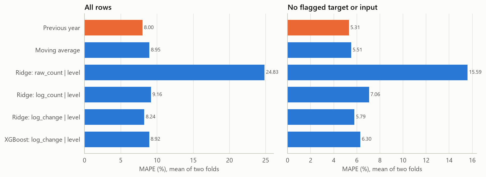
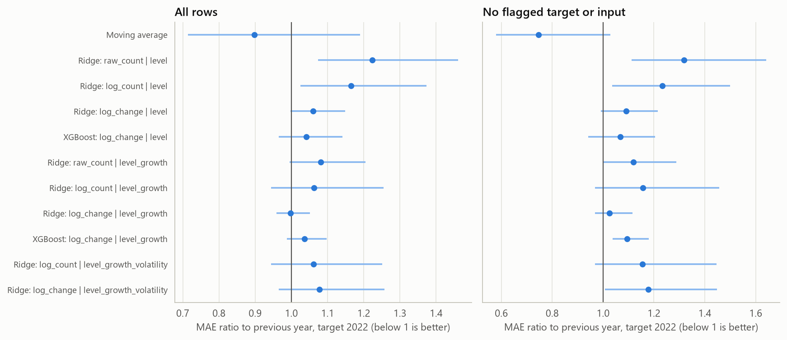
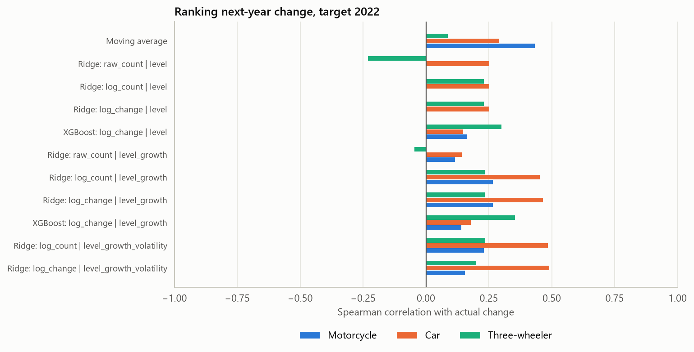

# Machine-Learning Experiments on Dataset v2

**Dataset:** `modelling_dataset_v2_04eaecafd7e1`
**Status:** approved by the project author on 2026-11-07. Target year 2023 was not used for training, tuning or evaluation.

## 1. Summary

The question was whether machine learning can improve on a "same as last year" forecast of next-year revenue licences. On this evidence, it does not.

- **No model passed the success criteria.** Of 24 experiments (20 Ridge and 4 XGBoost), none had a lower MAE and MAPE than the baseline on both all rows and clean rows, and none had an MAE ratio interval entirely below 1.
- **Ridge came close but did not improve.** The closest over both folds was Ridge on log change, with an MAE ratio of 1.05 (1.00 to 1.12) and a MAPE of 8.24% against 8.00%.
- **XGBoost was no better than Ridge,** and over both folds its interval lies above 1: 1.08 (1.01 to 1.20).
- **Modelling log change was the most useful scale,** but mainly because it shrinks forecasts towards "no change". Raw counts were the worst and even produced impossible negative forecasts.
- **Ranking did not improve.** Level-only models cannot reorder districts within a vehicle type, so their level ranking is identical to the baseline's.
- **The one positive signal is weak.** Some models rank next-year change better than chance, but for level-only models this reduces to "smaller districts grow more", which fails for motorcycles.

This is a negative result on two evaluation years, and a valid answer to RQ3. Licence counts are a proxy for active vehicles, so none of these results measures mechanic demand.

## 2. Design

**Folds.** The same chronological development folds and evaluation rows as the baseline evaluation.

| Fold | Predicts | Rows scored | Training target years, level features | Training target years, growth features |
|---|---|---:|---|---|
| Fold 1 | 2021 | 71 | 2020 | Not possible: no growth exists yet |
| Fold 2 | 2022 | 74 | 2020-2021 | 2021 |

Fold 2 is the only fold for growth features, and they train on a single year.

**Preventing leakage.**
- A training row's target year must not be later than the fold's origin year.
- Scaling, encoding and hyperparameters are fitted inside the training rows only.
- No value is imputed. A row missing an input or target is left out of training.
- Target year 2023 is never used.

**Targets.** The approved primary target is the raw count. Log count and log change are investigated as ways of modelling it. Every forecast is converted back to a count before scoring, with no adjustment for retransformation.

**Features.** All models include `vehicle_type`, one-hot encoded.

| Feature set | Numeric inputs | Why | Folds |
|---|---|---|---|
| Level | Log licence count | Current size, the strongest and most complete input | 1, 2 |
| Level + growth | Adds `licence_growth_log` | The only momentum signal | 2 |
| Level + growth + volatility | Adds log `licence_rolling_std_3` | Different information from level | 2 |
| Level + growth + registrations | Adds log `total_registrations` and `total_registrations_growth_log` | Approved secondary signal; verified Totals only | 2 |

With the raw-count target, level is entered as a raw count. `licence_lag_1`, `licence_lag_2`, `licence_rolling_mean_3`, `district` and `year` are excluded as redundant or unsuitable, for the reasons in `reports/baseline_v2/feature_selection.csv`.

**Hyperparameters.** Chosen by 5-fold cross-validation across districts, inside training rows only, minimising MAE in licences.

| Model | Search | Fixed |
|---|---|---|
| Ridge | alpha: 0.01, 0.1, 1, 10, 100, 1000 | |
| XGBoost | max_depth: 1, 2; n_estimators: 50, 100 | learning_rate 0.05, min_child_weight 5, reg_lambda 5, subsample 1, colsample_bytree 1 |

The values chosen for each fit are in `experiments.csv`, and Ridge coefficients are in `coefficients.csv`. 9 of 26 Ridge fits chose an alpha at the edge of the grid, so a wider grid might choose differently. Districts are held out across the same years, so this tunes for new districts rather than a new year.

**Evaluation.** Metrics, row rules and bootstrap intervals use the baseline evaluation's code, so results are directly comparable. Models in a comparison are scored on identical rows. Intervals are 95%, from 5,000 resamples of whole series.

**XGBoost gate.** Fixed before any Ridge result was seen: run XGBoost only if a Ridge model has a lower MAE and MAPE than the baseline on both row sets, or a positive change ranking in every vehicle type and evaluated fold.

The gate **opened through the second route only.** No Ridge model met the accuracy route. Some met the change route, but only on target 2022, and none across both folds. Since the rule was fixed in advance, XGBoost was run, restricted to the log-change target because trees cannot predict beyond the values seen in training.

## 3. Results against the previous-year baseline

### 3.1 Both folds, level features (145 rows)

The fairest comparison, as it covers both years. Mean of two folds, all rows.

| Model | MAE | MASE | MAPE | Median APE | Spearman (level) | Top-5 |
|---|---:|---:|---:|---:|---:|---:|
| **Previous year** | 4,136 | 1.00 | 8.00 | 3.79 | 0.980 | 0.967 |
| Moving average | 4,350 | 1.04 | 8.95 | 5.41 | 0.981 | 0.967 |
| Ridge, raw count | 5,574 | 1.34 | 24.83 | 9.97 | 0.980 | 0.967 |
| Ridge, log count | 5,005 | 1.21 | 9.16 | 6.08 | 0.980 | 0.967 |
| Ridge, log change | 4,326 | 1.05 | 8.24 | 4.75 | 0.980 | 0.967 |
| XGBoost, log change | 4,486 | 1.08 | 8.92 | 6.25 | 0.981 | 0.967 |

MAE ratio to the previous-year baseline, with 95% interval. Below 1 is better.

| Model | All rows (145) | No flagged target or input (116) |
|---|---:|---:|
| Ridge, raw count | 1.34 (1.17 to 1.63) | 1.43 (1.21 to 1.81) |
| Ridge, log count | 1.21 (1.06 to 1.42) | 1.29 (1.12 to 1.58) |
| Ridge, log change | 1.05 (1.00 to 1.12) | 1.08 (1.01 to 1.20) |
| XGBoost, log change | 1.08 (1.01 to 1.20) | 1.13 (1.02 to 1.30) |



### 3.2 Target 2022 only, with growth features (74 rows)

One year, with models trained on one year, so this is weak evidence.

| Model | MAE | MASE | MAPE | Median APE | MAE ratio, all rows | MAE ratio, clean rows |
|---|---:|---:|---:|---:|---:|---:|
| **Previous year** | 4,893 | 1.26 | 9.31 | 4.15 | | |
| Moving average | 4,392 | 1.13 | 9.70 | 5.57 | 0.90 (0.71 to 1.19) | 0.75 (0.58 to 1.03) |
| Ridge, log change, level | 5,183 | 1.33 | 9.33 | 4.34 | 1.06 (1.00 to 1.15) | 1.09 (0.99 to 1.22) |
| Ridge, log change, level + growth | 4,884 | 1.25 | 9.75 | 4.64 | 1.00 (0.96 to 1.05) | 1.02 (0.97 to 1.12) |
| Ridge, log change, + volatility | 5,270 | 1.35 | 9.70 | 5.38 | 1.08 (0.97 to 1.26) | 1.18 (1.01 to 1.45) |
| XGBoost, log change, level + growth | 5,068 | 1.30 | 10.06 | 5.54 | 1.04 (0.99 to 1.10) | 1.09 (1.04 to 1.18) |

Ridge with growth matches the baseline's MAE (4,884 against 4,893) but has a worse MAPE. The moving average, a baseline, has a lower MAE than any model here, although its intervals include 1.



### 3.3 Registrations (59 rows)

Registration features did not help. On the log-count target, Ridge's MAE was **2.13 times the baseline's (1.56 to 3.18)**. A plausible reason is the structural break: it learned from one year's registrations, then was applied to 2021, after they fell sharply. On log change, the same inputs were roughly level with the baseline, 1.04 (0.99 to 1.13), so they added nothing. Using them also costs 15 of 74 rows.

### 3.4 Success criteria

| Criterion | Experiments meeting it |
|---|---|
| 1. Lower MAE and MAPE on all rows and clean rows | **0 of 24** |
| 2. MAE ratio interval entirely below 1 on both row sets | **0 of 24** |
| 3. Spearman and top-5 on levels no lower than the baseline's, in every comparison | 12 of 24, mostly because level-only models repeat its order |
| 4. Positive change ranking in every vehicle type (needed for any claim about change) | None across both folds; some on target 2022 alone (see Section 6) |

Full results for every experiment are in `success_criteria.csv`. The moving average, which is not an ML model, meets criterion 1 only on the 59-row registration subset.

## 4. By vehicle type

Both folds, all rows.

| Vehicle type | Model | MAE | MASE | MAPE | Spearman (level) | Top-5 | Spearman (change) |
|---|---|---:|---:|---:|---:|---:|---:|
| Motorcycle | Previous year | 7,185 | 1.31 | 6.12 | 0.983 | 1.00 | not possible |
| | Ridge, log change | 7,575 | 1.38 | 6.24 | 0.983 | 1.00 | -0.002 |
| | XGBoost, log change | 7,677 | 1.40 | 6.73 | 0.984 | 1.00 | 0.023 |
| Car | Previous year | 2,057 | 1.19 | 8.82 | 0.992 | 0.90 | not possible |
| | Ridge, log change | 2,031 | 1.17 | 8.87 | 0.992 | 0.90 | 0.373 |
| | XGBoost, log change | 2,018 | 1.16 | 9.01 | 0.992 | 0.90 | 0.245 |
| Three-wheeler | Previous year | 3,290 | 0.64 | 8.98 | 0.967 | 1.00 | not possible |
| | Ridge, log change | 3,503 | 0.68 | 9.54 | 0.967 | 1.00 | 0.389 |
| | XGBoost, log change | 3,891 | 0.73 | 10.92 | 0.967 | 1.00 | 0.378 |

Cars are the only type where a model has a lower MAE, by about 1-2%, and its MAPE is still higher. There are about 24 rows per fold, so differences this small should not be over-interpreted.

## 5. Sensitivity to flagged observations

Both folds, MAPE. Scenarios change which rows are scored, so compare models within a row.

| Rows scored | Rows | Previous year | Ridge, log change | Ridge, log change, clean training | XGBoost, log change | XGBoost, log change, clean training |
|---|---:|---:|---:|---:|---:|---:|
| All rows | 145 | 8.00 | 8.24 | 8.03 | 8.92 | 8.24 |
| No flagged target | 138 | 5.96 | 6.27 | 6.10 | 6.97 | 6.24 |
| No flagged target or input | 116 | 5.31 | 5.79 | 5.72 | 6.30 | 5.81 |
| Also no outlier candidates | 111 | 4.81 | 5.32 | 5.25 | 5.92 | 5.34 |

- **The previous-year baseline has the lowest MAPE in every row in this table.**
- **Removing flagged rows from scoring lowers every model's error,** but does not change the order.
- **Removing flagged rows from training makes little difference.** For Ridge and XGBoost on log change, it lowers MAPE over both folds, but Ridge's MAE rises slightly (4,326 to 4,359), and MAPE rises on target 2022 alone (Ridge 9.33 to 9.49). This also uses hindsight, as flags were decided using all years, so a live forecast could not do the same.

## 6. Log counts, changes and ranking

**Does a log scale help?** Yes, compared with raw counts, though not compared with the baseline. Over both folds, MAPE falls from 24.83% (raw) to 9.16% (log count) and 8.24% (log change). Raw-count Ridge also produced 3 impossible negative forecasts across its fits, which were left unclipped so that the errors stay visible.

**Why does log change do best?** Ridge penalties pull coefficients towards zero. On a log-change target, that means pulling towards "little change", which is close to the baseline. For log-change Ridge trained on all rows, cross-validation chose heavy penalties (alpha of 10 or 100 in every fit). So the data favours forecasts close to persistence.

**Do these models rank better?**
- **Levels: no.** A model using only level and vehicle type is a monotonic function of current size within a vehicle type. Its level ranking is therefore identical to the previous-year baseline's, and it could not have improved it.
- **Change: only weakly.** Ridge's change ranking over both folds is 0.253, but this reduces to "smaller districts grow more". That simple rule, with no fitting, gives the same result:

| Vehicle type | Target 2021 | Target 2022 |
|---|---:|---:|
| Motorcycle | -0.004 | -0.001 |
| Car | 0.494 | 0.252 |
| Three-wheeler | 0.549 | 0.230 |

So it has no value for motorcycles, the project's first scenario. For the others, it could partly reflect small-count noise, or recovery after dips.

**Growth features.** On target 2022, adding growth lifts the change ranking from 0.160 to 0.322, with a small negative growth coefficient (a fast-growing series tends to slow down). That is one year, and it overlaps the recoveries from 2021 dips seen in the baseline evaluation. Its direction accuracy (0.488) is no better than chance.



## 7. Limitations

1. **Very few years.** Two target years overall, one for growth features, and both overlap the 2020-2022 structural break. A different period could give a different answer, in either direction.
2. **Very little training data over time.** Fold 1 trains on one year; fold 2 on at most two. Models may fail here simply because they have seen so little, so this does not prove that ML could never help.
3. **Many comparisons.** With 24 experiments and three comparison sets, a chance success was possible. None occurred on accuracy, but the change rankings should be read with this in mind. The intervals are not adjusted for it.
4. **Intervals describe districts, not years.** They resample series within these years, and do not capture uncertainty from having so few years or from errors shared by a whole district table.
5. **Hyperparameter choice.** Tuning across districts does not test a new year, and some alphas sit at the grid edge. XGBoost's grid is deliberately small, so a larger search is untested, but with so few rows it would risk overfitting.
6. **Retransformation.** Log-scale forecasts are converted back with no bias adjustment, which tends to give median-like values.
7. **Hindsight.** Flags and corrections were decided using all years, so clean-row results and clean training could not be reproduced live.
8. **Target year 2023 is not truly unseen,** because EDA and cleaning displayed its values. It remains unused here for training, tuning and evaluation.
9. **Proxy target.** Licences reflect renewals, and these models do not measure mechanic demand.

## 8. Conclusion and next steps

**On this evidence, the previous-year baseline remains the model to beat, and no ML model has earned a place ahead of it.** The stability of the target is the main reason: with a typical yearly change of about 4%, and little that predicts it, there is little left for a model to learn.

Options for the project author to consider:

1. **Run the final test on 2023,** once, with the choice of models frozen in advance. A sensible frozen list would be: the previous-year baseline, the moving average, and Ridge on log change with level features.
2. **Do not tune further on these folds.** More experiments would increase the risk of finding a chance winner.
3. **Consider more history.** Earlier handbook editions are the most promising way to get more evidence.
4. **Consider the ranking output carefully.** Given these results, broad opportunity bands based on current fleet size are easier to defend than a predicted ranking, and they keep the dashboard's explanation simple. Any change to the dashboard or website would need separate approval.

## 9. Reproducing the results

```
python -m src.models.ml_experiments_v2
```

The pipeline stops unless the dataset matches the frozen Dataset v2 hash. It writes only to `reports/ml_v2/` and `mlruns_v2/`, leaving the v1 `mlruns/` store untouched. Each run adds new MLflow runs to `mlruns_v2/`, which is not tracked by git. No fitted model is saved to `models/`.
